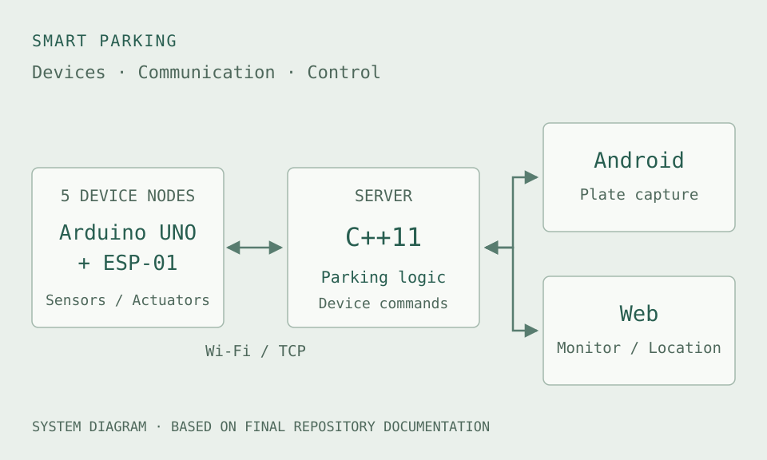
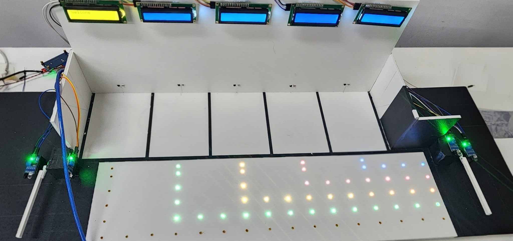
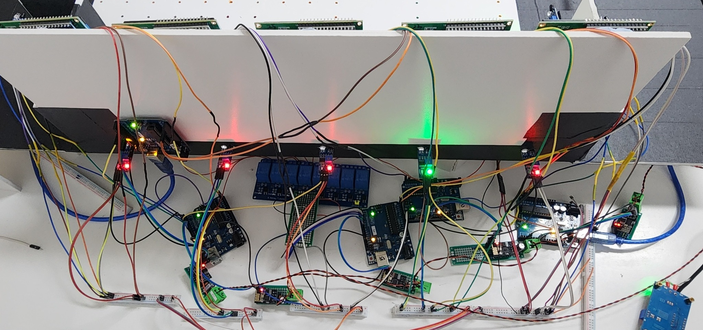

## 프로젝트 개요

센서로 주차 상태를 확인하고, 입출구 차단봉과 주차 공간 안내등을 제어하는
스마트 주차장 모형을 만들었습니다. Arduino UNO와 ESP-01로 구성한 장치 5대가
Wi-Fi로 C++ 서버에 연결됩니다. 서버는 각 장치의 상태를 받아 주차 공간을 배정하고
차단봉과 안내등에 명령을 보냅니다.

Android 앱은 번호판 촬영을, 웹 화면은 주차 상태 관제와 주차 위치 확인을 담당합니다.

> 팀 전체의 시스템 구성과 구현 내용을 함께 소개합니다. 제가 직접 참여한 작업은
> 아래 ‘나의 참여 범위’에 정리했습니다.

## 나의 참여 범위

- **주차 로직 설계:** 입차·주차·출차 과정을 단계별 동작으로 구체화했습니다.
  차량 감지와 주차 상태 확인, 차단봉과 안내 장치의 동작을 하나의 흐름으로 정리했습니다.
- **Arduino 5대 통합:** 따로 시험하던 보드 5대를 하나의 서버에 연결하는 작업에
  참여했습니다. 보드마다 다른 장치 식별자(`DEVICE_ID`)를 설정한 펌웨어를 업로드해,
  서버가 각 보드를 구분하고 해당 보드에 연결된 센서와 제어 장치를 다룰 수 있도록 했습니다.
- **서보모터 제어 안정화 검토:** ESP-01 통신이 서보 제어 타이밍에 영향을
  줄 가능성을 살펴봤습니다. 서보모터를 움직일 때만 제어 신호를 출력하는 방법을 검토했습니다.
- **프로젝트 발표:** 팀 프로젝트의 시스템 구조와 주요 기능, 기술적 문제와 대응 과정을 발표했습니다.

## 시스템 구성

*팀 최종 저장소의 문서를 바탕으로 그린 시스템 구성도입니다.*

각 보드는 서버와 통신합니다. 서버는 하나의 프로세스에서 보드 5대와 Android 앱,
웹 화면의 연결을 처리합니다.

| 구성 | 역할 |
| --- | --- |
| P1 | 주차 공간 A1~A3와 입구 센서 |
| P2 | 주차 공간 A4~A5와 출구 센서 |
| P3 / P4 | 입구 / 출구 차단봉의 서보 제어 |
| P5 | 주차 공간 안내등의 릴레이 제어 |
| C++ 서버 | 장치 연결, 주차 규칙, 화면과 앱의 요청 처리 |
| Android 앱 | 서버 요청에 따른 번호판 촬영 |
| 웹 화면 | 주차 상태 관제, 주차 위치 확인, 별도의 자리 선택 화면 |

각 보드에는 LCD가 연결되어 있습니다. 펌웨어는 `ardu/`, 주차 서버는 `server/`,
앱과 화면은 각각 `android/`, `web/`로 분리되어 있습니다.

### 실행 구성

최종 README의 서버 실행 명령은 `./srv --no-chooser`입니다.
아래 입차 흐름은 이 명령으로 실행하는 **자동 자리 배정 모드**를 기준으로 정리했습니다.

## 주요 구현

### Arduino 5대 통합

초기에는 팀원들이 각자의 PC에서 서버를 실행하며 보드를 따로 시험했습니다.
당시 펌웨어에는 같은 장치 식별자(`DEVICE_ID`)가 하드코딩되어 있어,
여러 보드를 하나의 서버에 연결하기 위한 구분이 필요했습니다.

제가 참여한 통합 작업에서는 각 보드의 식별자를 `P1`~`P5`로 설정하고,
수정한 펌웨어를 해당 Arduino에 업로드했습니다. 이렇게 각 보드를 구분해야
서버가 어느 보드에서 상태를 보냈는지 확인하고, 명령도 해당 보드에 전달할 수 있습니다.

| 항목 | 통합 전 | 통합 후 |
| --- | --- | --- |
| 서버 | 팀원별 PC에서 각각 실행 | 하나의 서버에 Arduino 다섯 대 연결 |
| 보드 식별 | 같은 `DEVICE_ID` 사용 | 보드마다 `P1`~`P5` 설정 후 펌웨어 업로드 |
| 동작 확인 | 보드별 기능 시험 | 보드 5대를 연결해 전체 주차 흐름 시연 |

최종 모형에서는 전원 하나로 보드 5대를 구동했습니다.
시연은 이 모형에서 진행했으며, 실제 주차장에 설치하거나 운영한 프로젝트는 아닙니다.

### 입차 흐름

차량이 들어와 주차를 마칠 때까지의 순서입니다.

<ol class="flow-diagram">
  <li>입구 감지<small>센서 상태를 서버로 전달</small></li>
  <li>번호판 촬영<small>Android 앱에 요청하고 응답 수신</small></li>
  <li>자리 안내<small>자동 배정한 공간의 안내등 점등</small></li>
  <li>차단봉 개방<small>입구 차단봉과 LCD 제어</small></li>
  <li>차량 통과<small>입구 통과 후 차단봉 닫기</small></li>
  <li>주차 확인<small>점유 상태 반영, 안내등 소등과 번호 기록</small></li>
</ol>

운전자가 진입 전에 주차할 위치를 알 수 있도록, 배정된 자리의 안내등을 먼저 켠 뒤
차단봉을 엽니다.

### 장치와 서버의 통신

장치 통신에는 한 줄 단위의 텍스트 프레임을 사용합니다.

| 프레임 | 방향 | 의미 |
| --- | --- | --- |
| `S` | 보드 → 서버 | 센서와 장치 상태 |
| `D` | 보드 → 서버 | 모듈 구성 등록 |
| `A` | 보드 → 서버 | 명령에 대한 응답 |
| `G` | 서버 → 보드 | 장치 명령 |

상태 보고, 모듈 등록, 명령 응답을 각각 다른 프레임으로 구분합니다.
체크섬 검사와 명령 번호를 통한 응답 확인, 중복 명령 처리와 재전송 기능도 포함합니다.

`DEVICE_ID`는 각 보드의 스케치(`p1.ino`~`p5.ino`)에 정의되어 있으며,
`S` 상태 프레임에 포함됩니다. 서버는 이 값을 `devid`로 관리해 보드를 구분합니다.
모듈에 명령을 보낼 때는 **장치 ID와 모듈 이름의 조합**으로 대상을 찾아 해당 보드의
연결로 명령을 보냅니다. 장치 식별자(`DEVICE_ID`)는 보드를 구분하는 값이고,
요청 번호(`rid`)는 명령과 응답을 짝짓는 값입니다.

관련 코드: [상태 프레임 생성](https://github.com/pi-lee-lee/team/blob/main/%EA%B3%BC%EC%A0%9C/1/release/ardu/p1/Modules.h#L315),
[장치 식별](https://github.com/pi-lee-lee/team/blob/main/%EA%B3%BC%EC%A0%9C/1/release/server/nodes.h#L18),
[명령 대상 조회](https://github.com/pi-lee-lee/team/blob/main/%EA%B3%BC%EC%A0%9C/1/release/server/downlink.h#L393)

## 기술 선택과 판단

팀에서 통신과 센서 상태를 처리할 때 고려한 제약과 구현 방식입니다.

| 문제 | 구현 방식 | 고려한 점 |
| --- | --- | --- |
| UNO ↔ ESP-01의 SoftwareSerial 송수신 제약 | 장치가 송신하는 시간과 서버 명령을 받는 시간을 구분 | 송신과 응답 대기 시점을 함께 관리 |
| 응답을 기다리는 동안 다른 처리가 멈춤 | 보드는 `millis()`, 서버는 `select()` 이벤트 루프 사용 | 긴 대기를 줄이고 다른 이벤트도 처리 |
| 연결 끊김이나 센서 오류로 주차 상태를 알 수 없음 | `occupied`와 `value_state`를 함께 확인하고 `unknown` 상태 유지 | 측정하지 못한 자리를 빈자리로 판단하지 않기 |

서버에서는 통신 엔진이 이벤트를 전달하고, `lot.cpp`가 주차 규칙을 처리하도록
역할을 나눴습니다.

## 문제 해결 기록

### 서보모터 제어 안정화 검토

ESP-01 통신이 서보모터의 제어 타이밍에 영향을 줄 가능성을 살펴봤습니다.
`SoftwareSerial` 송신 중 인터럽트가 제한되면, 서보 제어 펄스를 LOW로 내리는 시점이
늦어질 수 있다고 생각했습니다. 다만 파형을 측정해 확인한 원인은 아닙니다.

서보모터를 움직일 때만 제어 신호를 출력하는 방법을 검토했습니다.
`servo.attach()`를 호출하고 `servo.write()`로 각도를 지정한 뒤,
이동할 시간을 주고 `servo.detach()`로 신호 출력을 멈추는 방식입니다.
통신과 서보 제어 신호가 겹치는 시간을 줄이려는 목적이었습니다.

최종 시연에서는 차단봉이 떨림 없이 동작했습니다.

아래 두 항목은 제가 직접 검토한 서보모터 문제와 별개로, 팀에서 다룬 문제입니다.

### ESP-01 연결 끊김

ESP-01의 연결이 반복해서 끊기는 문제가 있었습니다. 팀에서는 절전 설정,
시리얼 수신 버퍼, 송수신 타이밍과 블로킹 대기 구간을 점검했습니다.

AT 초기화 과정에서 절전 기능을 끄고, 루프에서 수신 데이터를 계속 처리하도록 했습니다.
장치가 송신하는 시간과 서버 명령을 받는 시간도 나누었습니다.
각 변경이 연결 안정성에 얼마나 영향을 줬는지는 원본 로그와 시험 조건을 더 확인해야 합니다.

### 명령을 보내지 못했는데 성공으로 표시된 로그

등록되지 않은 모듈에 명령을 보내지 못했는데도, 로그에는 안내등을 켰다고
표시되는 문제가 있었습니다.

팀에서는 명령을 보내는 함수의 반환값을 확인하고, 명령을 보내지 못한 경우에는
실패 로그를 따로 남기도록 수정했습니다. 안내등을 켜라는 명령을 요청한 것과
실제로 안내등이 켜진 것은 구분해서 확인해야 합니다.

## 결과와 확인 자료

최종 시연에서 입차·자리 안내·주차·출차의 전체 흐름이 원활하게 동작했습니다.
차단봉 서보모터의 떨림도 나타나지 않았습니다.

최종 저장소에서 보드별 펌웨어와 C++ 서버, Android 앱, 웹 화면, 시스템 설명서를
확인할 수 있습니다.

### 실제 제작 모형

*팀에서 제작한 모형의 앞면입니다. 주차 공간과 안내 장치의 배치를 볼 수 있습니다. 사진 출처: 팀 발표자료.*

*모형 뒷면의 Arduino 보드와 ESP-01, 릴레이 배선입니다. 사진 출처: 팀 발표자료.*

### 코드와 시스템 설명

- [팀 최종 저장소와 README](https://github.com/pi-lee-lee/team)
- [네트워크와 패킷 흐름](https://github.com/pi-lee-lee/team/blob/main/%EA%B3%BC%EC%A0%9C/1/release/doc/1-%EB%84%A4%ED%8A%B8%EC%9B%8C%ED%81%AC%EC%99%80-%ED%8C%A8%ED%82%B7-%ED%9D%90%EB%A6%84.md)
- [동작 구조와 시퀀스](https://github.com/pi-lee-lee/team/blob/main/%EA%B3%BC%EC%A0%9C/1/release/doc/2-%EB%8F%99%EC%9E%91%EA%B5%AC%EC%A1%B0%EC%99%80-%EC%8B%9C%ED%80%80%EC%8A%A4.md)

시스템 구성과 통신 방식은 팀 최종 저장소의 README와 동작 설명서를 기준으로 정리했습니다.
개인 참여 내용과 최종 시연 결과에는 직접 수행하고 확인한 내용을 담았습니다.

